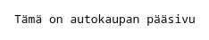
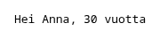
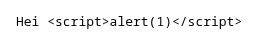

# s23demo

First Spring Boot demo from the autumn 2023 back-end programming course. Three endpoints that return plain text, in Finnish.

Endpoints:
- `/main` returns "Tämä on autokaupan pääsivu" (this is the car shop's main page)
- `/moi?nimesi=Anna` returns "Hei Anna". The name defaults to Veeti
- `/moi2?nimesi=Anna&ika=30` returns "Hei Anna, 30 vuotta". Defaults: Veeti, 22

Screenshots from a local run of the fixed code, 25 October 2026:



`/main`



`/moi2?nimesi=Anna&ika=30`



`/moi?nimesi=<script>alert(1)</script>` shows the tag as text and doesn't run it.

Stack: Java 17, Spring Boot 3.1.3 (web starter), Maven wrapper. The code is in `demo/`.

Run:

```
cd demo
./mvnw spring-boot:run       # macOS / Linux
mvnw.cmd spring-boot:run     # Windows
```

Then open http://localhost:8080/main

Test: `./mvnw verify` in `demo/` runs MockMvc tests of the endpoints.

Review, October 2026:
- The endpoints are GET only and always answer `text/plain`. Before, a browser got the answer as `text/html`, so `/moi?nimesi=<script>...</script>` ran the script (reflected XSS).
- `mvnw` is executable now.

The `main` branch has a separate version, the week 1 submission from 30 August 2023, with `/index`, `/contact` and `/hello?location=...&name=...`. It shares no history with `master` and wasn't changed in the review, so it still has the same XSS on `/hello` and a non-executable `mvnw`.

Status: course demo, 1 commit on 24 August 2023.
